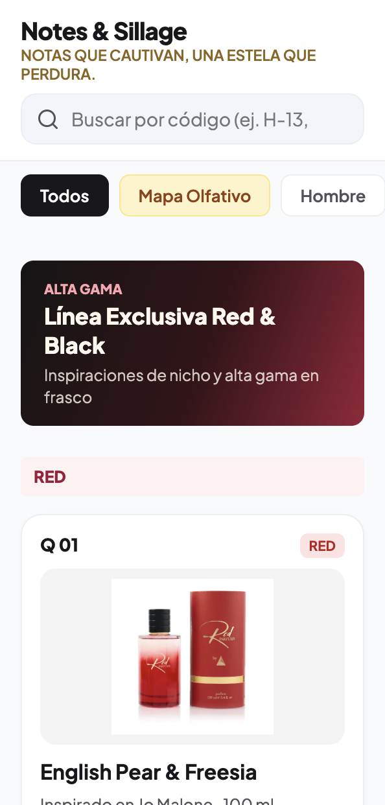
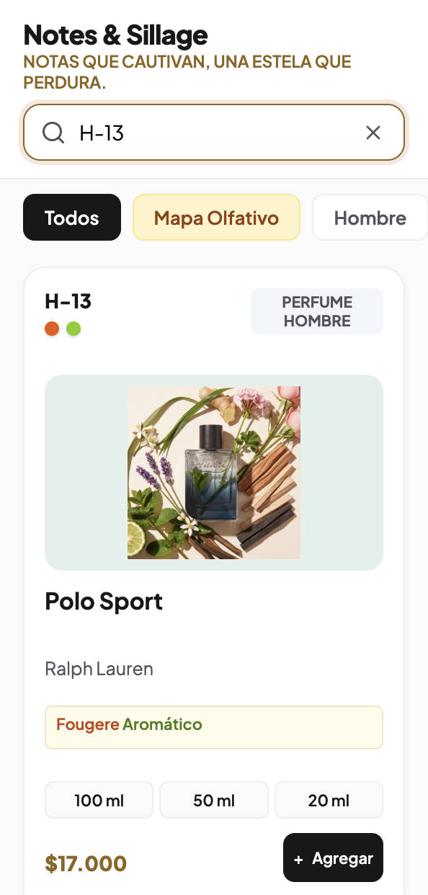
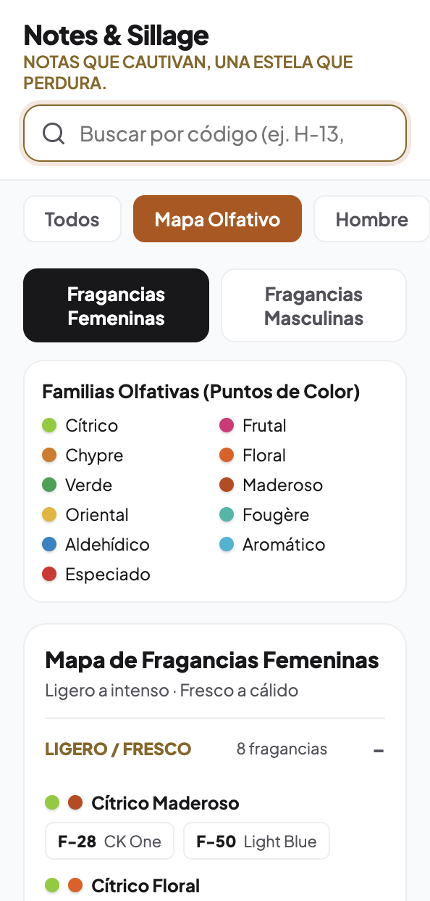

<div align="center">

# ⚜️ D & G Parfums — Catálogo Digital de Fragancias

**Catálogo digital exclusivo de perfumería fina y cosmética**  
*Votre essence, votre style*

[](https://developer.mozilla.org/es/docs/Web/HTML)
[](https://developer.mozilla.org/es/docs/Web/CSS)
[](https://developer.mozilla.org/es/docs/Web/JavaScript)
[](https://pages.github.com/)

[🌐 Ver catálogo en línea (GitHub Pages)](https://deralexsander.github.io/d-and-g-parfums/)

</div>

---

## 📌 1. Historia y Origen del Proyecto

El desarrollo de este catálogo surge como un encargo directo derivado del éxito y la óptima experiencia de usuario lograda en el catálogo digital de *Notes & Sillage*. 

Al presenciar la inmediatez de carga, la navegación intuitiva *mobile-first* y la facilidad para explorar fragancias sin la pesadez de una tienda online tradicional, la dirección de **D & G Parfums** solicitó el desarrollo de una plataforma propia a medida. 

El requerimiento fue preciso y estratégico:
- **Identidad de Marca Exclusiva:** Adaptar la estética completa al logotipo oficial de la maison, adoptando una paleta refinada de marfil cálido, carbón profundo y tonos taupe/champagne con el lema distintivo: *«Votre essence, votre style»*.
- **Catálogo de Consulta Inmediata:** Prescindir de sistemas de compra, carritos flotantes o pasarelas de pago. La premisa central es servir como un expositor digital directo para que los clientes consulten en el momento notas aromáticas, familias olfativas y precios destacados de forma clara y sin distracciones.
- **Arquitectura Liviana y Confiable:** Mantener un sitio 100% estático, con base de datos unificada en JavaScript local, sin dependencias de bases de datos externas o Firestore.

---

## ✨ 2. Funcionalidades Principales

| Funcionalidad | Descripción |
| :--- | :--- |
| 🔎 **Búsqueda inteligente** | Búsqueda en tiempo real por nombre del perfume, código (`H-13`, `F-01`, `Q 51`) o aroma, con tolerancia a acentos y mayúsculas. |
| 💡 **Sugerencia de búsqueda** | Si no se hallan coincidencias exactas por error de tipeo, propone el perfume más cercano disponible en la base de datos. |
| 🧭 **Mapa Olfativo Interactivo** | Brújula visual organizada en cuatro cuadrantes de intensidad para fragancias femeninas y masculinas. |
| 🌿 **Familias y notas olfativas** | Puntos de color y notas descriptivas que representan la composición y estilo de cada fragancia. |
| 🖼️ **Alternancia de imagen** | Permite alternar de forma táctil entre la inspiración aromática y la presentación del frasco. |
| 🏷️ **Precios destacados** | Exhibición clara y en tipografía de gran formato del valor correspondiente al formato estándar de cada producto. |
| 🗂️ **Categorización completa** | Pestañas superiores para filtrar por Colección Red & Black, Hombre, Mujer, Línea Teen, Colonias Corporales, Splash y Cremas. |

---

## 📸 3. Vistas del Catálogo

| Catálogo Principal | Búsqueda Inteligente |
| :---: | :---: |
|  |  |
| *Acceso directo a colecciones, buscador y tarjetas con precio destacado.* | *Búsqueda instantánea con resaltado y borrado rápido.* |

<div align="center">

### Mapa Olfativo Interactivo
  
*Brújula olfativa para orientar la elección del cliente según frescura e intensidad.*

</div>

---

## 📂 4. Estructura del Proyecto

```text
d-and-g-parfums/
├── index.html           # Página principal del catálogo digital
├── favicon.ico          # Favicon oficial D & G Parfums
├── css/
│   └── estilos.css      # Sistema de diseño, paleta luxury y estilos responsive
├── js/
│   ├── base-datos.js    # Catálogo local de productos, notas, familias y precios
│   └── app.js           # Búsqueda interactiva, mapa olfativo y visualización de aromas
├── img/                 # Fotos de frascos, imágenes de aroma y logos oficiales
│   ├── logo-dg.jpg      # Logotipo oficial D & G Parfums
│   ├── promocional/     # Recursos gráficos y favicons
│   ├── Fragancias Masculinas/
│   ├── Fragancias Femeninas/
│   ├── Red parfums/
│   ├── Black parfums/
│   ├── teen/
│   ├── Colonias Hombre/
│   ├── colonias mujer/
│   ├── colonia splash/
│   └── cremas/
└── docs/                # Documentación y capturas
    └── img/             # Capturas del catálogo
```

---

## 🚀 5. Ejecutar en Local

Al tratarse de un sitio web estático sin dependencias externas, puede ejecutarse con cualquier servidor HTTP local:

```bash
# 1. Clonar el repositorio
git clone https://github.com/deralexsander/d-and-g-parfums.git

# 2. Acceder al directorio
cd d-and-g-parfums

# 3. Iniciar el servidor local
python3 -m http.server 8000
```

Luego abre en tu navegador:
```text
http://localhost:8000
```

---

## 🌐 6. Despliegue en GitHub Pages

El catálogo está optimizado para su despliegue continuo mediante **GitHub Pages** desde la rama `main`:
- **URL pública:** [https://deralexsander.github.io/d-and-g-parfums/](https://deralexsander.github.io/d-and-g-parfums/)
- Sin dependencias de servicios externos ni certificados manuales; respaldado por la CDN y HTTPS nativo de GitHub Pages.

---

<div align="center">

**Maison D & G Parfums** · *Votre essence, votre style*  
Desarrollado por [Alexsander Muñoz](https://github.com/deralexsander)

</div>
